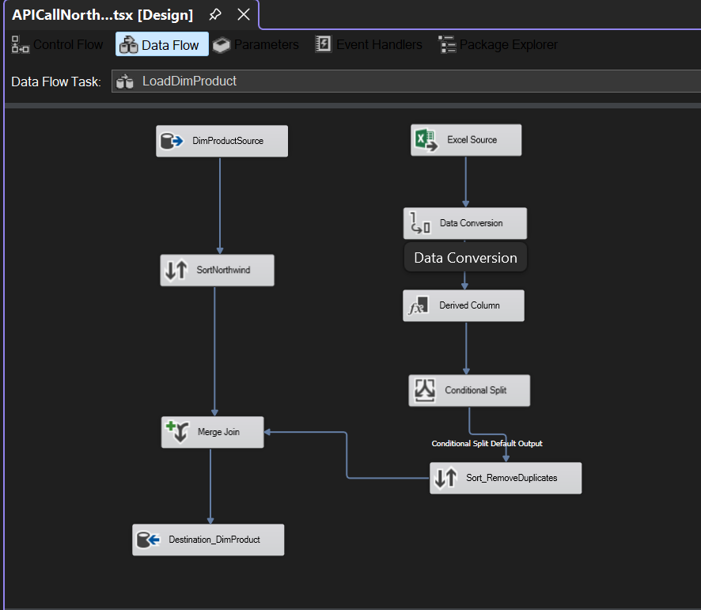

# SSIS-ETL-Northwind-DW

# SSIS ETL Pipeline – Northwind Data Warehouse

An SSIS ETL pipeline that extracts data from multiple sources, cleans and transforms it, and loads it into a star schema data warehouse.

## Tools
SSIS, SQL Server, ETL architecture, data integration

## What I did
- Designed and built an SSIS pipeline to extract, clean and transform data from multiple sources
- Called an API to fetch source data, including API-based currency conversion
- Handled data cleaning: managing null values and removing duplicates
- Created the data warehouse with three dimension tables (Customer, Product, Date) and a Sales fact table
- Truncated the tables before each load so the pipeline can be re-run safely
- Loaded the dimension tables first and the fact table last, because the fact table depends on the dimensions

## Control flow

## Data flow

The package starts with the API call and creates the warehouse and its tables. It then truncates the tables, loads the three dimensions in parallel, and finally loads the fact table.

## What I learned
- How to design an ETL pipeline from start to finish, from extraction through cleaning and transformation to loading
- Why load order matters: dimension tables must be loaded before the fact table so that the keys exist
- Why data quality has to be handled early: null values and duplicates cause problems in the warehouse if they aren't dealt with during the ETL stage
- How to make a pipeline repeatable by truncating tables before loading
- How to bring in external data through an API, including currency conversion, and combine it with other sources

## Data
Northwind sample database. 
